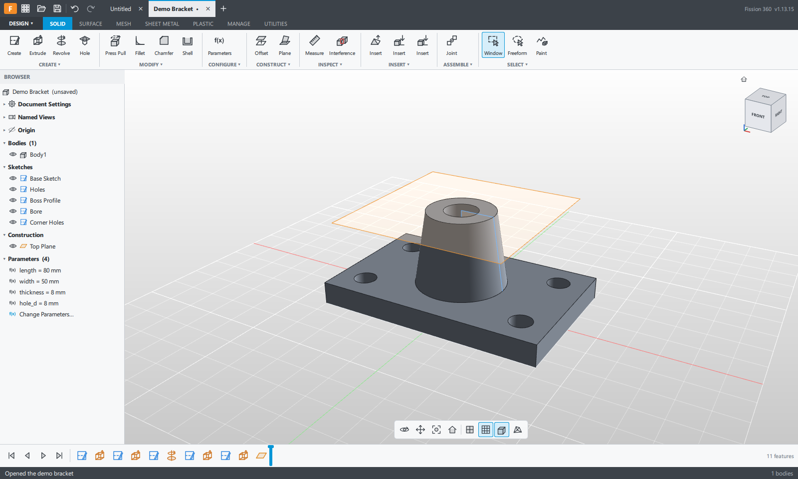

# Fission 360

**Status:** Active development · **Windows** (primary) · GPL-3.0-or-later · not a 1.0 release

A fast, offline, parametric 3D CAD application. Designs are a **timeline of editable features** you can scrub, reorder and re-dimension — not a bag of frozen mesh files. No cloud, no sign-in, no subscription. The whole design lives in one `.f360` file you own.

**Where Fission sits:** Fission is the OCCT-backed, print-shop CAD — industry STEP/IGES through [Open CASCADE](https://dev.opencascade.org/), a **`.f360` import** path from a companion exporter add-in, and **one-click Send to Slicer** (OrcaSlicer / Bambu Studio). It is not trying to be the only open CAD on GitHub; it is the one that speaks manufacturing file formats and your existing slicer workflow. Other open projects (including [SolidCraft](https://github.com/tangency-labs/solidcraft)) prove the category is real — we stay clean-room relative to them too: **ideas and public docs only, never their source.**

Written clean-room: the codebase is hand-built and not derived from any other CAD product. Every class, dialog, and algorithm was designed and implemented from first principles.



## What it does

- **Parametric solid modelling** — extrude, revolve, sweep, loft, fillet (constant & variable radius), chamfer, shell, hole + thread (ISO coarse/fine, UNC/UNF, clearance & tap drill), combine, move, scale, split body/face, offset face, draft (plane/edge/axis pull), joint / as-built joint, pattern (incl. on-path), rib, web.
- **Primitive solid bodies** — box, cylinder, sphere, torus, coil (helical tube), pipe (swept tube along a straight axis), each with a live spec dialog to tune its size and position.
- **Sketching** — line, arc, circle, rectangle, spline with a live solver, geometric constraints and dimensions.
- **Construction geometry** — planes, axes, points; planar face selection for sketch planes and direct face extrudes/revolves/sweeps.
- **In-viewport interaction** — floating draggable dialogs, in-viewport sketch preview with dimension text boxes, and feature drag handles (extrude distance/taper, fillet, chamfer, hole depth) that accept typed values.
- **Bodies & components** — multi-body, body appearance (per-body PBR material: color, roughness, metalness, opacity, texture map), component colour cycling.
- **Mesh bodies** — import STL/OBJ, smooth, reduce, plane-cut, convert to B-rep (fitted planes/cylinders/cones/spheres/B-splines).
- **Inspection** — measure, interference, section cut, and surface analyses (curvature comb, curvature map, draft, iso-curve, zebra) done in the renderer.
- **Sheet metal** — flange, edge flange, contour flange, hem, tab, bend, flat pattern, unfold/refold, flat-pattern DXF.
- **2D drawings** — HLR-projected base/projected/section/detail/auxiliary views on a sheet; dimensions picked on model edges (length, distance, angle, radius, diameter); notes with size, bold and italic; PDF/DXF/PNG/TIFF export.
- **Rendering** — PBR materials, HDRI/IBL environments, PBR texture maps, CPU Monte-Carlo path tracer.
- **Import / interop** — STEP, IGES, STL, OBJ. **Import `.f360` files** written by the companion Fission 360 Exporter add-in.
- **Send to slicer** — tessellate **visible** bodies to STL and launch **OrcaSlicer** or **Bambu Studio**. Display Settings ▸ Slicer: auto-detect, force one slicer, **Browse…** or **Search for slicer** (finds custom builds). Hidden bodies are never sent.
- **Document history** — compressed save snapshots live **inside** the `.f360` (`history` array). The same file stores a result cache of the solids at the timeline marker, so the next open can skip the rebuild. Crash autosave stays in AppData. Legacy `<file>.f360.versions/` folders are imported on open and removed after the next save.

## The file format

A Fission 360 design is a single JSON file with a `.f360` extension. It stores the feature timeline, parameters, sketches, appearance, a capped **version history** (`history`), and a **result cache**: the compressed solids at the timeline marker where the file was saved. Opening a matching file restores those solids and that marker instead of replaying the timeline. Change a feature, a parameter, or the units, and the next open rebuilds. Undo steps and version snapshots omit the cache. No history folder sits beside the file.

## Tech stack

- **C++20** kernel and UI glue
- **Qt 6** (Quick / QML, Quick Shapes, WebEngine, Network) for the UI
- **Open CASCADE Technology (OCCT) 7.6** as the B-rep modelling kernel (STEP/IGES/STL I/O)
- **CMake** build system

The UI is QML compiled into the executable — no external QML asset tree to load at runtime.

## Build (Windows)

Supported and tested on **Windows 10/11** with **Visual Studio 2022** (or Build Tools) and **CMake 3.22+**.

### 1. Qt 6.8 (open-source)

Install next to this repo (or inside it) with [aqtinstall](https://github.com/miurahr/aqtinstall):

```sh
pip install aqtinstall
aqt install-qt windows desktop 6.8.2 win64_msvc2022_64
```

CMake looks for Qt at `../6.8.2/msvc2022_64` (sibling of the `fission360` folder) or `./6.8.2/msvc2022_64`.

### Python scripting (optional)

With Python 3.11 or newer installed (python.org, 64-bit), CMake finds its development files and builds Python scripts and add-ins in. Fission loads `python3.dll` from the user's own Python when a script runs, so the app still starts without Python. Without Python at build time the Scripts dialog says Python support was not built in.

### 2. OpenCASCADE 7.6

The easiest path is to reuse OCCT from a built **OrcaSlicer** dependency tree:

```sh
cmake -S . -B build-rel -DFISSION_ORCA_ROOT=C:/path/to/MyOrcaSlicer
cmake --build build-rel --config Release --target Fission360
```

You can also set the `FISSION_ORCA_ROOT` environment variable. If unset, CMake tries `../MyOrcaSlicer` and `%USERPROFILE%/Documents/GitHub/MyOrcaSlicer`.

A standalone OCCT 7.6 install is not wired up yet — today the build expects the OrcaSlicer deps layout (`deps/build/dep_OCCT-prefix/...` and `OrcaSlicer_dep/usr/local/include/occt`).

### 3. Run / package a Windows release

After a successful build, Qt's `windeployqt` and the OCCT DLLs are copied next to the exe under `build-rel/Release`.

```powershell
powershell -File scripts/package-windows.ps1
```

That writes `dist/Fission360-<version>-windows-x64/` and a matching `.zip` (exe + Qt/OCCT/WebEngine runtime + `LICENSE` + `THIRD_PARTY_NOTICES.md` + `README.md`). For day-to-day testing, `dist/Fission360` points at the same tree.

Self-test (no GUI): `Fission360.exe --selftest`.

### macOS / Linux

**No release builds yet.** Deploy is still Windows-oriented (`/EHa`, `windeployqt`, Orca-deps OCCT paths). A design for native CI packaging is in [`docs/ci-release-sketch.md`](docs/ci-release-sketch.md):

- Workflow stub: [`.github/workflows/release.yml`](.github/workflows/release.yml) (all jobs `if: false` until Qt/OCCT caches and Unix CMake land)
- Packaging stubs: `scripts/package-macos.sh`, `scripts/package-linux.sh`

Until CMake gains portable OCCT discovery, `MACOSX_BUNDLE` / `macdeployqt`, and Linux `linuxdeploy`, only the Windows zip above is a supported distributeable.

## Import from the Exporter add-in

The companion exporter lives in **`F3D_Bulk_Export/`** in this repo (Python + `.manifest`). Install it in your CAD app, run the exporter on a design, and open the resulting `.f360` in Fission. Version of the add-in should match the notes in `FISSION_360_PROJECT.md`.

A design opens in its own units (mm, cm, m, in or ft); sketches and solids keep their true size. Re-export with add-in 1.10 or later for sketches that sit exactly where they were in the source.

Designs that insert other designs keep that link. Export each folder into the matching folder under the Fission projects folder (`<project>/<folders>/<design>.f360`), and the inserted design shows up under **Linked Designs** in the browser, where you can open it. Its geometry inside the assembly is still the snapshot the exporter wrote.

## Roadmap status

Solid / sketch / mesh / sheet-metal features, inspection, drawings, rendering, parametric timeline, undo/redo, version history (inside the `.f360`), autosave, **Send to Slicer**, startup update check, **Report Bug**, and a headless **MCP** server (`Fission360 --mcp`) are in. Current source: **1.13.41**. Latest GitHub release: **1.13.41** (`Fission360-1.13.41-windows-x64.zip`). Up next: real CAM toolpaths and optional lock/sync.

MCP / command registry notes: [`docs/mcp.md`](docs/mcp.md). Peer ideas (oracle tests, installers, …) — **not** their source: [`docs/peer-inspiration.md`](docs/peer-inspiration.md). SolidCraft issue recipes: [`docs/solidcraft-issue-parity.md`](docs/solidcraft-issue-parity.md).

More detail: [`CHANGELOG.md`](CHANGELOG.md) · [`FISSION_360_PROJECT.md`](FISSION_360_PROJECT.md)

## License

Fission 360 is free software under the **GNU GPL v3 or later** (`LICENSE`). Every source file carries an `SPDX-License-Identifier: GPL-3.0-or-later` header — please keep that on new files.

It ships with open-source components under their own licenses (**Qt** LGPL-3.0, **OCCT** LGPL-2.1 with exception, **FreeType**, **Qt WebEngine / Chromium**). See [`THIRD_PARTY_NOTICES.md`](THIRD_PARTY_NOTICES.md) for the list, trademarks, and the source-code offer.

**Binary releases** must include `LICENSE` and `THIRD_PARTY_NOTICES.md` next to the executable, and a link to the matching source tag.

## Contributing

Issues and pull requests are welcome. Please:

- Keep changes focused; match the existing C++ / QML style.
- Add the SPDX + copyright header on new `.cpp` / `.h` / `.qml` / `.py` files.
- Do not commit reference material, secrets, or large unrelated binaries.

## Clean room

Fission 360 is a clean-room build. Every class, dialog, and algorithm was implemented by hand — no code, QML, icons, or assets were copied from any other CAD product. Behaviour and UI patterns were derived from first principles and public-domain knowledge only.

The codebase was written through AI-assisted vibe coding and iterative testing: features are built, run, and verified against real models in the same session, so what ships is what was actually exercised.

## Trademark note

**Fission 360 is not affiliated with, endorsed by, or sponsored by Autodesk, OrcaSlicer, or Bambu Studio.** "OrcaSlicer" and "Bambu Studio" are trademarks of their respective owners. SolidCraft is an independent open-source project; Fission is not affiliated with tangency-labs or SolidCraft.
